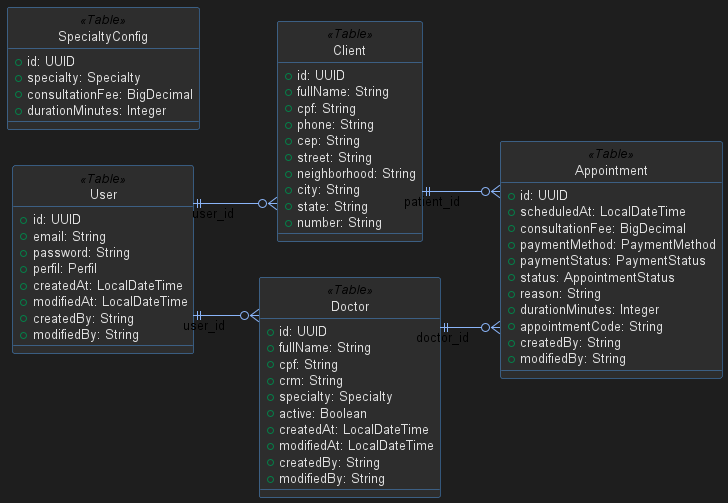

# API de Clínica Médica

Este projeto é uma API REST para organizar algumas rotinas de uma clínica: cadastro de pacientes e médicos, agendamento de consultas e emissão de relatórios. A ideia é manter essas informações em um só lugar e controlar o acesso de acordo com o perfil de cada usuário.

## O que a API oferece

- Cadastro de usuários, pacientes e médicos.
- Login com JWT e permissões para `ADMIN`, `DOCTOR` e `USER`.
- Agendamento de consultas com escolha de um médico ativo da especialidade e verificação de conflito de horário.
- Configuração de preço e duração das consultas por especialidade.
- Consulta e atualização de dados do próprio perfil.
- Busca de endereço pelo CEP usando o ViaCEP.
- Relatórios de consultas em PDF para pacientes e administradores, incluindo filtro por CRM.
- Paginação nas listagens que retornam vários registros.

## Tecnologias

- Java 21 e Spring Boot 4
- Spring Web MVC, Spring Data JPA e Hibernate
- Spring Security e JWT
- PostgreSQL
- MapStruct, Lombok e Bean Validation
- Springdoc OpenAPI (Swagger)
- JasperReports para geração de PDF
- Maven e Docker Compose

## Modelo de dados

O diagrama mostra as principais entidades e seus relacionamentos:



As entidades centrais são `User`, `Client`, `Doctor`, `Appointment` e `SpecialtyConfig`. Um usuário pode ter um perfil de paciente ou médico, e cada consulta associa um paciente a um médico.

## Requisitos

- JDK 21
- PostgreSQL
- Git
- Docker e Docker Compose, se preferir subir os serviços em containers

O Maven Wrapper já está incluído no projeto, então não é necessário instalar o Maven separadamente.

## Configuração local

Na configuração padrão, a aplicação usa PostgreSQL. Crie um banco de dados e defina estas variáveis de ambiente antes de iniciar:

| Variável | Uso |
|---|---|
| `DB_URL` | URL JDBC, por exemplo `jdbc:postgresql://localhost:5432/clinica` |
| `DB_USERNAME` | Usuário do banco |
| `DB_PASSWORD` | Senha do banco |
| `JWT_SECRET` | Segredo usado para assinar os tokens JWT |
| `SPRING_PROFILES_ACTIVE` | Perfil do Spring; pode ser `dev` ou `prod` |
| `INITIAL_ADMIN_EMAIL` | E-mail do administrador inicial (opcional) |
| `INITIAL_ADMIN_PASSWORD` | Senha do administrador inicial, com pelo menos 12 caracteres (opcional) |

No PowerShell, por exemplo:

```powershell
$env:DB_URL="jdbc:postgresql://localhost:5432/clinica"
$env:DB_USERNAME="postgres"
$env:DB_PASSWORD="sua-senha"
$env:JWT_SECRET="use-um-segredo-longo-e-aleatorio"
```

Depois, na raiz do projeto, inicie a aplicação:

```powershell
.\mvnw.cmd spring-boot:run
```

No Linux ou macOS, use `./mvnw spring-boot:run`.

Por padrão, o Hibernate está configurado com `ddl-auto: update`, inclusive no perfil `prod`, para criar e atualizar as tabelas ao iniciar. O perfil `dev` também habilita a exibição dos comandos SQL e o console H2; a conexão principal continua sendo a definida pelas variáveis do PostgreSQL.

## Executando com Docker Compose

O Compose sobe o PostgreSQL e a API na porta `8080`:

```bash
docker compose up --build
```

Para encerrar:

```bash
docker compose down
```

O arquivo `docker/init/01-schema.sql` cria as tabelas quando o PostgreSQL inicializa um volume vazio. A API também cria ou atualiza as tabelas ao iniciar. Esse script é usado pelo Docker Compose e não adiciona dependências nem altera as classes Java.

Scripts em `/docker-entrypoint-initdb.d` só são executados na primeira inicialização do volume. Se você já tinha subido o banco antes dessa configuração, o script não será aplicado automaticamente ao volume existente; nesse caso, aplique o SQL manualmente no banco. As credenciais definidas no Compose são apenas para uso local; não as use em produção.

## Publicando no Render

O repositório contém um `Dockerfile` pronto para o Render. No painel, crie um serviço **Web Service** conectado a este repositório e selecione o ambiente **Docker**. Crie também um PostgreSQL no Render, de preferência na mesma região do serviço, e configure estas variáveis no Web Service:

| Variável | Valor |
|---|---|
| `SPRING_PROFILES_ACTIVE` | `prod` |
| `DB_URL` | `jdbc:postgresql://<HOST_INTERNO>:5432/<NOME_DO_BANCO>` |
| `DB_USERNAME` | Usuário informado pelo PostgreSQL do Render |
| `DB_PASSWORD` | Senha informada pelo PostgreSQL do Render |
| `JWT_SECRET` | Segredo longo, aleatório e exclusivo para essa instância |
| `INITIAL_ADMIN_EMAIL` | `admin.demo@clinica.com` |
| `INITIAL_ADMIN_PASSWORD` | `ClinicaDemo@2026!` |

Use o host interno, o nome do banco, o usuário e a senha exibidos nos detalhes do PostgreSQL do Render; não use as credenciais do Docker Compose. O Render fornece a variável `PORT` para o serviço, e a aplicação a utiliza automaticamente. Com `ddl-auto: update`, as tabelas são criadas na primeira inicialização e o administrador de demonstração também é criado. Depois do deploy, abra `/swagger-ui/index.html` no endereço público do serviço.

As credenciais administrativas acima são públicas. Mantenha nessa instância apenas dados fictícios e não use a configuração de demonstração para dados de pacientes ou em produção real.

## Autenticação

Para obter um token, envie e-mail e senha para `POST /api/v1/auth`. Nas demais rotas protegidas, envie o token no cabeçalho:

```http
Authorization: Bearer <token>
```

O cadastro público cria usuários com perfil `USER`. A criação de usuários `DOCTOR` e as configurações administrativas são restritas ao perfil `ADMIN`. Para agendar uma consulta, o usuário precisa ter criado seu perfil de paciente, e a especialidade deve estar configurada e contar com um médico ativo disponível.

### Acesso administrativo para testes

Este usuário e senha são fictícios e servem para testar as funcionalidades administrativas da API:

| Campo | Valor |
|---|---|
| E-mail | `admin.demo@clinica.com` |
| Senha | `ClinicaDemo@2026!` |

Ao iniciar pelo Docker Compose, essas credenciais já são configuradas por padrão. Se iniciar a aplicação fora do Compose, defina `INITIAL_ADMIN_EMAIL` e `INITIAL_ADMIN_PASSWORD` com os valores acima. Depois, acesse o Swagger, faça uma requisição `POST /api/v1/auth` com o e-mail e a senha e use o token retornado no botão **Authorize** para testar as rotas administrativas.

Essas credenciais são públicas e dão acesso de administrador a qualquer pessoa. Use-as somente em uma instância de demonstração com dados fictícios; não reutilize essa senha em outros serviços nem use essa configuração em produção. A aplicação cria o administrador na primeira inicialização e armazena a senha usando BCrypt. Se a conta já existir como administradora, a senha não é redefinida nas próximas inicializações. Sem as duas variáveis, nenhum administrador é criado automaticamente.

## Principais rotas

| Recurso | Rotas |
|---|---|
| Autenticação | `POST /api/v1/auth` |
| Usuários | `POST /api/v1/users/register`, `POST /api/v1/users/doctor`, `GET /api/v1/users`, `GET /api/v1/users/{id}`, `PATCH /api/v1/users/{id}/password` |
| Pacientes | `GET`, `PUT` e `PATCH /api/v1/clients/me` |
| Médicos | `GET` e `PUT /api/v1/doctors/me`, `GET /api/v1/doctors/{id}`, `PATCH /api/v1/doctors/{id}` |
| Consultas | `POST` e `GET /api/v1/appointments`, `GET /api/v1/appointments/code/{code}`, `PUT /api/v1/appointments/{id}` |
| Especialidades | `POST /api/v1/specialties`, `GET /api/v1/specialties/{specialty}`, `PUT /api/v1/specialties/{specialty}` |
| Relatórios | `GET /api/v1/reports/me/appointments`, `GET /api/v1/reports/admin/appointments`, `GET /api/v1/reports/admin/appointments/doctor?crm=123456-SP` |

As permissões variam conforme a rota. A documentação interativa mostra os parâmetros e os formatos esperados para cada operação.

## Documentação da API

Com a aplicação em execução, acesse o Swagger em [http://localhost:8080/swagger-ui/index.html](http://localhost:8080/swagger-ui/index.html).

## Testes

Os testes de integração ficam em `src/test/java` e cobrem autenticação, usuários, pacientes, médicos, consultas, especialidades e relatórios. Para executá-los:

```powershell
.\mvnw.cmd test
```

## Organização do código

O código principal fica em `src/main/java/com/marquesdev/clinica`, separado por responsabilidade: `controller` recebe as requisições, `service` concentra as regras, `repository` acessa o banco, `entity` representa os dados e `dto` define os formatos de entrada e saída. Também há pacotes para autenticação, configuração, integração com ViaCEP e tratamento de erros.
